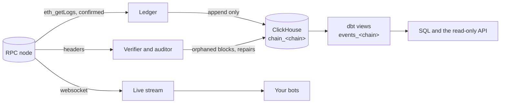

# chainindex

[](https://github.com/delia-gbv/chainindex/actions/workflows/ci.yml)
[](https://github.com/delia-gbv/chainindex/blob/main/pyproject.toml)
[](https://github.com/delia-gbv/chainindex/blob/main/pyproject.toml)
[](https://github.com/delia-gbv/chainindex/blob/main/LICENSE)

chainindex indexes EVM chains into ClickHouse. You list the contracts you care about; it stores their event logs,
checks the data against the chain, and lets you query the decoded events with SQL. It runs one service per chain.

## How it works

- **Store raw logs once, decode when reading.** Logs are saved exactly as the node returns them. dbt views, generated
  from the contracts' ABIs, decode them at query time. Adding an ABI later decodes all the history you already have,
  and there are no decoded tables to rebuild.
- **Index only what you ask for.** List addresses, or name a factory and get every contract it creates. Each contract
  has its own progress, so adding one at runtime fetches only its history.
- **Wait for confirmations, never delete.** A log is written once its block is a few dozen blocks deep. If that block
  is later replaced (a reorg), it is recorded in `orphaned_blocks` and the views skip it. Nothing is updated in place.
- **Check every block.** The verifier compares the hash of every stored block with the chain once it is 15 minutes
  old, and repairs any that changed. An auditor also re-fetches random ranges to catch missing logs.
- **Live events too.** A websocket stream delivers decoded events as soon as they happen, with reorg notices.
- **Use little RPC.** Each kind of work (live, history, headers, calls) has its own endpoint, rate and concurrency.
  Requests shrink when a provider refuses them and grow back when it does not.



## In production

chainindex runs on several EVM chains, one of them with sub-second blocks, against a public RPC provider. Each chain
takes under a tenth of a CPU core, under 1 GB of memory and under ten RPC requests a second, and writes up to millions
of logs a day. Heads arrive a fraction of a second after their timestamp.

## Install

```bash
uv tool install chainindex                    # or: pip install chainindex
docker pull ghcr.io/delia-gbv/chainindex      # or the image, for amd64 and arm64
```

## Quickstart

You need Docker and [uv](https://docs.astral.sh/uv/). The quickstart runs from a clone of the repository.

```bash
git clone https://github.com/delia-gbv/chainindex && cd chainindex
docker compose up -d                  # ClickHouse, chainindex following Base, and the API on :8080
uv sync
cd dbt && uv run dbt build --profiles-dir profiles && cd ..   # create the decoded views
curl localhost:8080/v1/base/status
```

Without an `RPC_API_KEY` (a [PublicNode](https://www.publicnode.com) token), only recent blocks can be fetched.

Then query ClickHouse directly:

```sql
SELECT block_number, sender, amount0, amount1
FROM events_base.aerodrome_cl_pool__swap
WHERE address = '0xb2cc224c1c9fee385f8ad6a55b4d94e92359dc59'   -- WETH/USDC
ORDER BY block_number DESC
LIMIT 10
```

## Indexing your own contracts

A chain file in `src/chainindex/chains/` lists what to index. Each entry is a contract kind with an ABI:

```yaml
contracts:
  - name: uniswap_v3_factory
    abi: UniswapV3Factory
    addresses: [{address: "0x1F7d7550b1B028f7571e69a784071f0205fd2EFa", start_block: 9000}]
    creates: {event: PoolCreated, param: pool, contract: uniswap_v3_pool}
  - name: uniswap_v3_pool          # every pool the factory creates
    abi: UniswapV3Pool
    track: created
    fetch: topics
```

Point `CHAININDEX_CHAINS_DIR` and `CHAININDEX_ABIS_DIR` at your own folders, then regenerate the views with
`chainindex dbt --models-dir dbt/models`.
[docs/chain-files.md](https://github.com/delia-gbv/chainindex/blob/main/docs/chain-files.md) covers every option.

## Commands

```bash
chainindex --chain base run        # index the chain: ledger, verifier, auditor, live stream on :8547
chainindex --chain base init       # create the database and record the chain file's contracts
chainindex --chain base status     # how far each contract has been indexed
chainindex --chain base contracts add aerodrome_cl_pool 0x... --from-block 50300000
chainindex --chain base probe      # what your RPC key allows
chainindex --chain base rebuild    # move tables to a new schema (stop the service first)
chainindex dbt --models-dir dbt/models   # regenerate the decoded views
chainindex tail ws://localhost:8547/stream --event Swap
chainindex api                     # the public read-only API
```

## Public API

`chainindex api` answers a few fixed queries over the decoded views:

```bash
curl localhost:8080/v1/chains        # chains, contract kinds and their events
curl localhost:8080/v1/base/status   # indexing progress, forks found, audits, how fast blocks arrive
curl 'localhost:8080/v1/base/events/aerodrome_cl_pool/Swap?address=0x...&limit=10'
curl 'localhost:8080/v1/ethereum/events/uniswap_v3_pool/Swap?from_block=26280000&to_block=26280100'
```

Clients cannot send SQL. Every value is a bound parameter, every query has time, row and memory limits, each client
has a request budget, and a request without an address covers at most an hour of blocks. Run it with a read-only
ClickHouse user. Settings are in
[docs/operations.md](https://github.com/delia-gbv/chainindex/blob/main/docs/operations.md#public-api).

## Documentation

- [docs/chain-files.md](https://github.com/delia-gbv/chainindex/blob/main/docs/chain-files.md): what to index and how to configure it.
- [docs/operations.md](https://github.com/delia-gbv/chainindex/blob/main/docs/operations.md): tables, reorgs and verification, the live stream, settings, metrics.
- [docs/design.md](https://github.com/delia-gbv/chainindex/blob/main/docs/design.md): why it is built this way, and how it compares with other indexers.

## Development

```bash
uv sync
uv run python -m pytest -q -m "not clickhouse and not e2e"        # unit tests, about 3 s
docker compose up -d clickhouse
uv run python -m pytest -q -m clickhouse                          # against ClickHouse and dbt
uv run python -m pytest -q -m e2e                                 # a real anvil node: confirmations, a deep reorg, restarts
uv run mypy && uv run ruff check src tests
```

See [CONTRIBUTING.md](https://github.com/delia-gbv/chainindex/blob/main/CONTRIBUTING.md) to send a change and
[CHANGELOG.md](https://github.com/delia-gbv/chainindex/blob/main/CHANGELOG.md) for what changed.

## License

MIT
